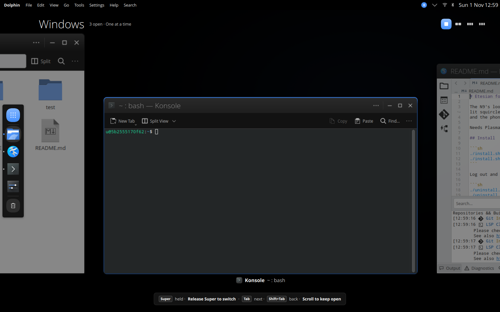
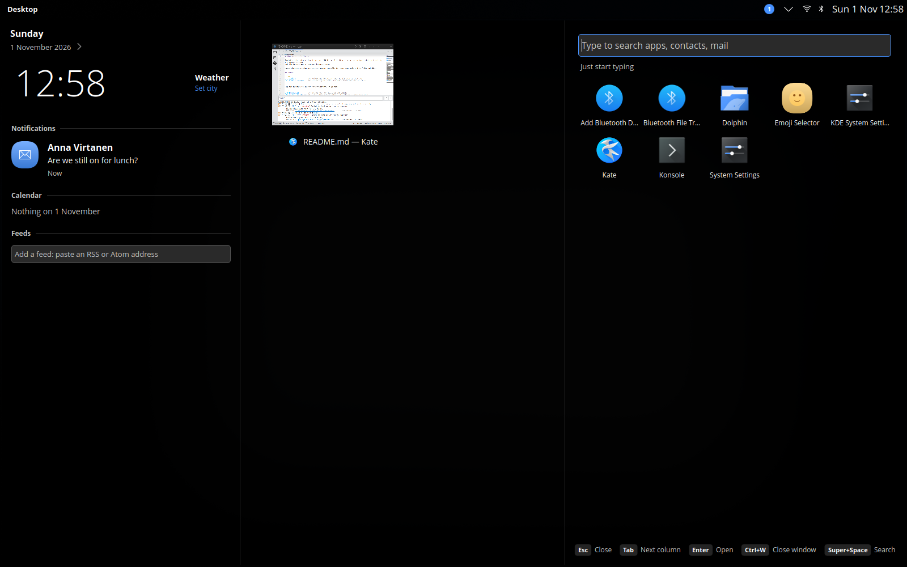
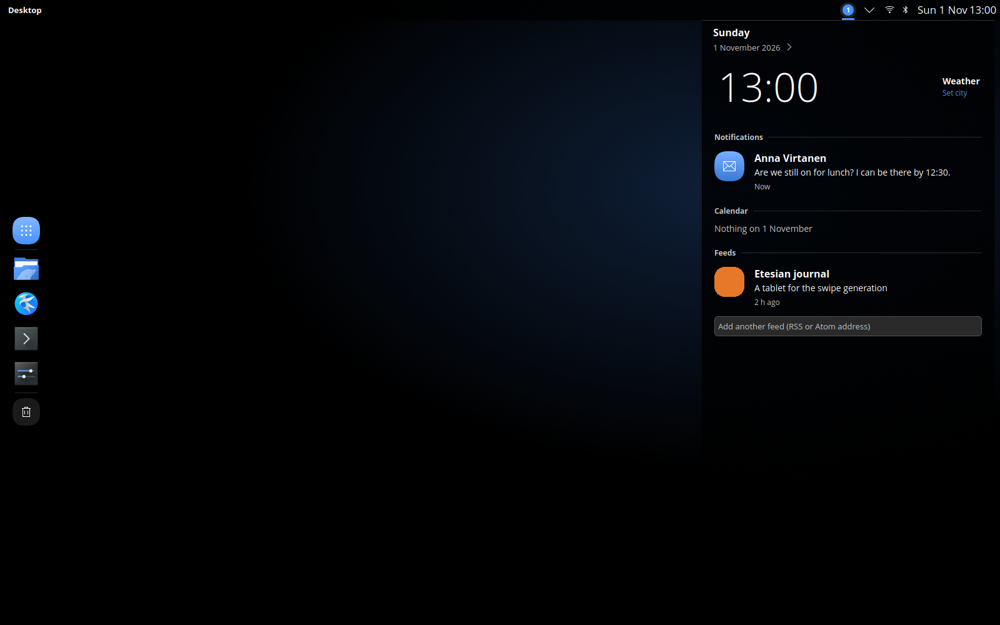

<p align="center">
  
</p>

<h1 align="center">Etesian for KDE Plasma</h1>

<p align="center">
  <b>The Nokia N9's look and feel, on your Linux desktop.</b><br>
  A global menu bar, a floating dock, the N9's carousel of open windows, and its Events view one keypress away.
</p>

<p align="center">
  <a href="https://etesian-design.com/desktop">Try it in your browser</a> ·
  <a href="https://etesian-design.com">Website</a> ·
  <a href="https://github.com/etesian-design/design">Design</a> ·
  <a href="https://github.com/etesian-design/android_vendor_etesian">Phone</a>
</p>

<p align="center">
  
  
  
</p>

---

Not a theme pack. Etesian changes how Plasma **works** as well as how it looks: the way you switch windows, snap them,
find apps and catch up on what's new. It installs for your user only, needs no root, and one command puts everything
back.

<table>
  <tr>
    <td></td>
    <td></td>
  </tr>
  <tr>
    <td align="center"><b>Overview</b>: tap Super, start typing</td>
    <td align="center"><b>Events</b>: notifications, calendar and feeds</td>
  </tr>
</table>

## Highlights

- **Windows, the N9 way.** Super+Tab shows one large card at a time; scroll to see 2, 3 or 4 per row.
- **Snapping that shows you where.** Drag a window and numbered zones appear. Drag it to the top for six layouts.
- **One place for what's new.** Events gathers notifications, today's calendar, your RSS feeds and the weather.
- **Window headers with the app's own actions.** Kate's New, Open and Save sit in the title bar, so a window has one
  row of chrome.
- **The whole look.** Colours, lit squircle icons, cursors, sounds, wallpaper, boot splash, login screen, and a
  matching Thunderbird theme.
- **Belle widgets** on the desktop: flip clock, word clock, feeds and mail.

## Install

Plasma 6.6 (Kubuntu 26.04) or newer.

```sh
./install.sh            # the look and behaviour; your panels stay as they are
./install.sh --layout   # also the Etesian menu bar and dock
```

Log out and back in once. Changed your mind?

```sh
./uninstall.sh          # everything back as it was
```

<details>
<summary>Building the native parts, the login screen, and going back to Breeze</summary>

The window header and the Mail widget's KMail support are small native plugins, built on install. With the build tools
installed they build on your machine:

```sh
sudo apt install cmake g++ extra-cmake-modules qt6-base-dev libkdecorations3-dev libkf6coreaddons-dev
sudo apt install qt6-declarative-dev libakonadi-dev libakonadimime-dev libkmime-dev   # Mail widget
```

Otherwise they build in a throwaway Docker container. If neither works, you get a simpler header
(`kwin-style-aurorae`). After a Plasma update, the simpler header is used until you run `./install.sh` again.

The login screen is system-wide, so it's a separate step:

```sh
sddm-greeter-qt6 --test-mode --theme look/sddm/etesian   # preview
sudo ./install-sddm.sh                                   # use it (--remove to undo)
```

`./uninstall.sh --breeze` switches to plain Breeze instead of your old settings; add `--layout` for Plasma's default
panels.
</details>

## Keys

| Keys | What they do |
|---|---|
| <kbd>Super</kbd> | Overview |
| <kbd>Super</kbd> <kbd>Space</kbd> | Search |
| <kbd>Super</kbd> <kbd>N</kbd> | Events |
| <kbd>Super</kbd> <kbd>Tab</kbd> | Open windows |
| <kbd>Super</kbd> <kbd>Z</kbd> | Snap layouts |
| <kbd>Super</kbd> <kbd>←</kbd> <kbd>→</kbd> <kbd>↑</kbd> <kbd>↓</kbd> | Move between columns, maximise, float |

On a touchpad: pinch with three fingers to zoom the windows view, swipe sideways with three fingers to minimise.

<details>
<summary>Settings and what isn't finished</summary>

In `~/.config/kwinrc`:

- `[Etesian] HeaderActionApps` lists the apps whose toolbar moves into the header (default: Kate, KWrite);
  `HeaderActions=false` turns it off.
- `[Effect-etesian_windows] SwipeDownClose=true` lets a three-finger swipe down close a window.

Not finished yet:

- Your own calendars, and people and mail in search, need KDE PIM.
- The Mail widget reads KMail only.
- Only some apps get their actions in the header, and KDE apps have no Back button.
</details>

## Contributing

The colours, icons and themes are generated by `scripts/*.ts`. Edit those scripts, not what they generate in `look/`.

Every change is tested on real Plasma sessions in throwaway Docker containers: on 6.6 and on the latest Plasma.
Nothing is installed on your machine.

```sh
test/all.sh               # everything
test/run.sh windows arch  # one scenario on one distro
test/lint.sh              # quick QML checks, no Docker
```

The tests need a GPU render node (`/dev/dri/renderD128`, or set `DRI_NODE`).

## Licence

MIT. Fira Sans (splash and login) is under the SIL OFL. No Nokia material.

Etesian is an independent project and isn't affiliated with Nokia.
